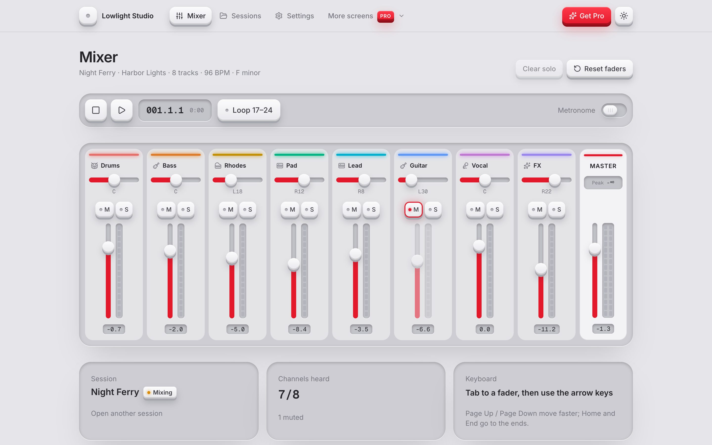

<div align="center">

# Lowlight Studio Lite

**A free music mixing dashboard with faders, meters and keys that feel like a real desk.**<br>
Mixer, sessions and audio settings, in light and dark. Built with [Thock UI](https://thock-ui.vercel.app).

[](LICENSE)


[**Full version demo**](https://lowlight-studio-demo.vercel.app) · [**Thock UI**](https://thock-ui.vercel.app) · [**Get the full template**](https://thock-ui.vercel.app/templates/studio)

<picture>
  <source media="(prefers-color-scheme: dark)" srcset=".github/assets/overview-dark.jpg">
  
</picture>

</div>

## At a glance

| | |
| --- | --- |
| **Screens** | 3: mixer, sessions, settings |
| **Looks** | Light and dark themes, works on phones and tablets |
| **Keyboard** | Every fader, pan slider and button works with the keyboard |
| **Data** | A demo session with eight tracks and animated meter levels |
| **Stack** | Next.js 16 (App Router), React 19, Tailwind CSS v4, Radix UI, lucide-react, next-themes |
| **Licence** | MIT: use it for anything, including commercial projects |

## Quick start

```bash
git clone https://github.com/intellaralabs/thock-studio-lite.git
cd thock-studio-lite
npm install
npm run dev        # open http://localhost:3000
```

Other scripts: `npm run build`, `npm start`, `npm run lint`. Open `/?play&at=17` to start the mixer playing from bar 17,
which is handy for demos and screenshots.

## Screens

| Route | What it shows |
| --- | --- |
| `/` | Mixer: transport with play, stop and loop; eight channel strips with pan, mute, solo, a fader and a live LED meter; master fader with a stereo meter |
| `/sessions` | Every session in a searchable table, filtered by status or stars; open a session or create a new one |
| `/settings` | Audio devices, sample rate and buffer size (with the latency they give), recording options, theme and profile |

## Project structure

```
app/                  layout.tsx (theme + state + shell) and one page per screen
components/ui/        Thock UI components (free, MIT; yours to edit)
components/lite/      app parts: shell, state provider, screens
data/studio.ts        demo data and the types the UI expects
lib/audio.ts          dB / pan / time formatting and the demo meter levels
lib/links.ts          links to the full template; set showProPreviews = false to remove them all
styles/tactile.css    design tokens: colours, raised and recessed surfaces, LEDs
```

## Connect a real audio engine

All state lives in `components/lite/studio-provider.tsx`. Screens only call `useStudio()` (`updateTrack`, `togglePlay`,
`stop`, `dispatch`). To drive real audio (Web Audio, a native engine or a hardware desk):

1. Load the session's tracks from your API instead of `data/studio.ts`.
2. In `StudioProvider`, send each action to your engine as well as to the reducer.
3. Replace the demo clock in `StudioProvider` with your engine's transport position.
4. Replace `demoLevel()` in `lib/audio.ts` with real levels (for example from an `AnalyserNode`).

## Make it yours

The "More screens" menu, the preview pages, the mixer teaser, the "Get Pro" button and the footer link to the full
template. One line in `lib/links.ts` switches them all off:

```ts
export const showProPreviews = false;
```

Then you can also delete `app/pro`, `data/pro-screens.ts`, `components/lite/pro-*.tsx` and `public/pro`. To restyle,
change the colour tokens in `styles/tactile.css`.

## Lite or full?

| | Lite (free) | [Full template](https://thock-ui.vercel.app/templates/studio) |
| --- | :---: | :---: |
| Screens | 3 | 12 + sign-in |
| Mixer with faders, mute/solo and meters | ✓ | ✓ |
| Sessions list and audio settings | ✓ | ✓ |
| Light and dark, phone-ready | ✓ | ✓ |
| Pan knobs, inserts, FX returns and loudness gauge | | ✓ |
| Arrangement timeline with editing tools | | ✓ |
| Playable synth instrument | | ✓ |
| Effects rack with EQ and compressor visuals | | ✓ |
| Sample browser, export wizard, collaborators | | ✓ |
| ⌘K command menu and keyboard shortcuts | | ✓ |
| Components | Free set | Free + Pro |
| Licence | MIT | Pro licence |

Try the full version: **[lowlight-studio-demo.vercel.app](https://lowlight-studio-demo.vercel.app)**

## Licence

[MIT](LICENSE) © Intellara Labs. Built with [Thock UI](https://thock-ui.vercel.app).
